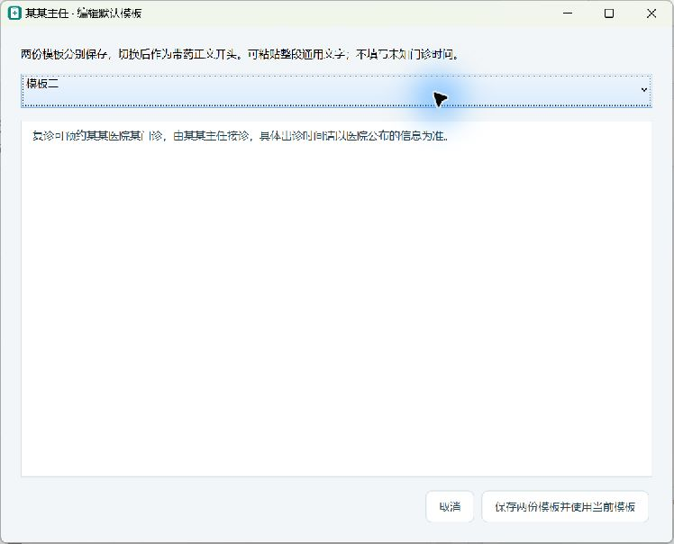

# 临床文书助手四合一 · v1.4.1-public 公开脱敏版

**中文 · English · Deutsch**

## 中文

离线 Windows 临床文书助手，包含出院带药、出院医嘱、入院首程、日常病程四个主入口，并整合辅助检查分类和离线检验文本整理。通过点选、模板及少量输入组织文字，核对后复制到医院系统。

**公开版已将默认模板、界面、测试和说明中的人员与地点信息替换为“某某主任”“某某医院”“某门诊”。** 两份复诊模板仍可分别切换；具体预约安排需由使用者自行填写，默认文字不提供真实人员的出诊时间。公开版使用独立的数据目录，不覆盖原私人版本的本机草稿和自定义模板。

[下载最新公开脱敏版](https://github.com/Goldrinn-wolf/clinical-document-assistant-public/releases/latest)：完整解压，双击 `先点这里_检测并启动.cmd`。含微软 .NET Framework 4.8 离线安装程序、公开版程序及其安装器。全部程序由脱敏源码重新构建，不包含原私人版本的安装包。

环境要求：.NET Framework 4.8；Win7 需要 SP1。程序为 x86，可用于符合环境要求的 32/64 位 Windows；不依赖 WebView2。Windows 7 实机和具体院内编辑器仍待现场验证。生成文书和原始检验文本需核对后使用。

## English

An offline Windows suite for discharge medication, discharge instructions, initial admission notes and daily progress notes, with examination-result categories and offline laboratory-text organization. Users prepare text through selections, templates and brief input, review it, then copy it into their hospital system.

**The public edition replaces identifying personnel and location information in defaults, UI, tests and documentation with generic placeholders.** The two follow-up templates remain independently selectable. Appointment details must be supplied by the user; defaults do not contain real clinicians' schedules. A separate local profile keeps the user's existing private-edition drafts and custom templates intact.

The [latest de-identified public release](https://github.com/Goldrinn-wolf/clinical-document-assistant-public/releases/latest) includes the application, its newly rebuilt public installer and the official .NET Framework 4.8 offline installer. Extract the entire archive and run `先点这里_检测并启动.cmd`. All application binaries are rebuilt from the de-identified source; the private-edition installer is excluded.

Requirements: .NET Framework 4.8, Windows 7 SP1 or a compatible later Windows system. This is an x86 application for compatible 32/64-bit Windows; WebView2 is not required. Native Windows 7 and specific hospital editors remain unvalidated. Review generated documents and original laboratory text before use.

## Deutsch

Eine Offline-Windows-Werkzeugsammlung für Entlassungsmedikation, Entlassungshinweise, Erstberichte bei Aufnahme und tägliche Verlaufsdokumentation, ergänzt um die Strukturierung von Untersuchungs- und Laborbefundtexten. Texte werden durch Auswahlfelder, Vorlagen und kurze Eingaben vorbereitet, geprüft und in das Krankenhaussystem kopiert.

**In der öffentlichen Version wurden identifizierende Personen- und Ortsangaben in Standardvorlagen, Oberfläche, Tests und Dokumentation durch allgemeine Platzhalter ersetzt.** Die beiden Vorlagen für die Wiedervorstellung bleiben getrennt auswählbar. Konkrete Sprechstundenangaben müssen selbst eingetragen werden; die Standardtexte enthalten keine realen Sprechstundenpläne. Ein eigenes lokales Datenverzeichnis lässt Entwürfe und angepasste Vorlagen der privaten Version unverändert.

Die [aktuelle öffentliche Version ohne identifizierende Angaben](https://github.com/Goldrinn-wolf/clinical-document-assistant-public/releases/latest) enthält die neu erstellte Anwendung, das öffentliche Installationsprogramm und den offiziellen Offline-Installer für .NET Framework 4.8. Das gesamte Archiv entpacken und `先点这里_检测并启动.cmd` starten. Sämtliche Programmdateien wurden aus dem bereinigten Quellcode neu erstellt; das Installationsprogramm der privaten Version ist nicht enthalten.

Voraussetzungen: .NET Framework 4.8, Windows 7 SP1 oder ein kompatibles neueres Windows-System. Die x86-Anwendung läuft auf kompatiblen 32-/64-Bit-Systemen und benötigt kein WebView2. Tests auf einem tatsächlichen Windows-7-System und in konkreten Krankenhaus-Editoren stehen noch aus. Erzeugte Dokumente und Laborbefundtexte müssen vor der Verwendung geprüft werden.

## Source / 源码 / Quellcode

- `Source/`: public WPF application, template resources and installer build scripts.
- `environment/`: dependency-check launcher and environment-package builder.
- `docs/verification/`: public-build checksums and validation records.
- [Build instructions](docs/BUILD.md) · [Public-edition review](docs/PUBLIC_EDITION.md) · [Third-party notices](THIRD_PARTY_NOTICES.md).

## Public template preview / 公开模板预览 / Vorlagenvorschau

